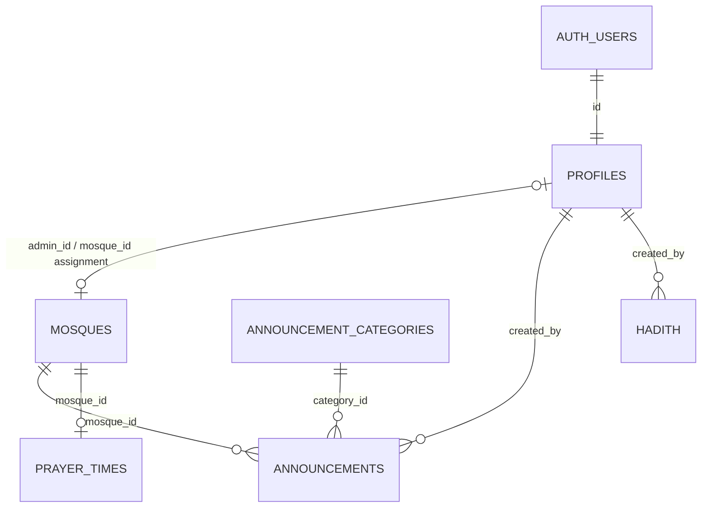

# Masjid Locator App: Database, RLS & Screen Integration Guide

> **Purpose:** A practical reference for building React Native / Expo screens against the current Supabase schema.
>
> **Source of truth:** This document was generated from a live schema and RLS-policy inspection on **21 October 2026**. It documents the observed database configuration, not an idealized future design. Re-run the checks after schema or policy changes.

## 1. Project overview

- **Backend:** Supabase (PostgreSQL, Auth, Storage)
- **Project ref:** `otnlqydfbqqmilvghdlg`
- **Public schema tables:** `profiles`, `mosques`, `announcements`, `announcement_categories`, `hadith`, `prayer_times`
- **RLS:** Enabled on all six tables
- **Storage bucket:** `mosque-images`
- **Roles stored in `profiles.role`:** `admin`, `super_admin`
- **Important:** The Supabase Auth user and the app profile are linked by the same UUID: `profiles.id = auth.users.id`.

Use the Supabase URL and publishable/anon key from your local environment. Never put the `service_role` key in the mobile app.

## 2. Entity relationship overview



### Assignment model

There are two synchronized assignment fields:

- `mosques.admin_id`: the profile assigned to administer that masjid.
- `profiles.mosque_id`: the masjid assigned to that admin profile.

Live schema triggers synchronize these fields. A unique constraint on each field enforces a one-admin-to-one-masjid relationship. A check constraint expects:
- `admin` profiles to have a non-null `mosque_id`
- `super_admin` profiles to have a null `mosque_id`

Do not independently update only one side in client code. Assign or reassign admins through the intended super-admin workflow, then verify both fields remain consistent.

## 3. Tables and columns

`uuid` fields are PostgreSQL UUIDs. `timestamptz` is a timestamp with time zone. Unless marked nullable, the listed columns are required.

### 3.1 `profiles`

Purpose: app profile and authorization role for a Supabase Auth user.

| Column | Type | Nullable | Default / rule |
|---|---|---:|---|
| `id` | `uuid` | No | Primary key; references `auth.users.id` |
| `name` | `text` | No | Display name |
| `email` | `text` | Yes | Unique |
| `phone` | `text` | Yes | Optional contact number |
| `role` | `text` | No | Only `admin` or `super_admin`; no default |
| `is_blocked` | `boolean` | No | `false` |
| `created_at` | `timestamptz` | No | `now()` |
| `updated_at` | `timestamptz` | No | `now()` |
| `mosque_id` | `uuid` | Yes | Unique; FK to `mosques.id` |

Important constraints:
- `profiles_role_check`: role is `admin` or `super_admin`.
- `profiles_role_mosque_assignment_check`: admins must have a masjid; super admins must not.
- `profiles.email` is unique when non-null.
- `profiles.id` must match the Auth user UUID.

Screen usage:
- **Profile/settings:** read the signed-in user's own profile.
- **Super-admin user management:** list profiles, create admin profiles, block/unblock, and manage assignments.
- **Admin dashboard:** read the current profile and its assigned masjid.

Do not expose role promotion or profile creation as an unrestricted client operation. Admin creation must use the approved privileged workflow; super-admin provisioning is intended to be performed directly through trusted Supabase administration.

### 3.2 `mosques`

Purpose: public masjid directory and admin assignment.

| Column | Type | Nullable | Default / rule |
|---|---|---:|---|
| `id` | `uuid` | No | Primary key; `gen_random_uuid()` |
| `name` | `text` | No | Masjid name |
| `address` | `text` | No | Street/local address |
| `city` | `text` | No | City |
| `latitude` | `double precision` | No | Map latitude |
| `longitude` | `double precision` | No | Map longitude |
| `image_url` | `text` | Yes | Optional image URL |
| `admin_id` | `uuid` | Yes | Unique; FK to `profiles.id` |
| `is_active` | `boolean` | No | `true` |
| `created_at` | `timestamptz` | No | `now()` |
| `updated_at` | `timestamptz` | No | `now()` |

Screen usage:
- **Nearby/list/map/detail:** fetch active masjids (`is_active = true`).
- **Admin dashboard:** load the assigned masjid.
- **Super-admin management:** list all masjids, create/edit/deactivate, and assign admins.

Coordinates should be validated before saving. A public read policy does not imply permission to create or edit rows.

### 3.3 `prayer_times`

Purpose: manually managed prayer and Jumu'ah times for a masjid.

| Column | Type | Nullable | Default / rule |
|---|---|---:|---|
| `id` | `uuid` | No | Primary key; `gen_random_uuid()` |
| `mosque_id` | `uuid` | No | FK to `mosques.id`; unique |
| `fajr` | `time` | No | Required |
| `dhuhr` | `time` | No | Required |
| `asr` | `time` | No | Required |
| `maghrib` | `time` | No | Required |
| `isha` | `time` | No | Required |
| `jummah` | `time` | Yes | Optional |
| `updated_at` | `timestamptz` | No | `now()` |

Constraint: `unique_mosque_prayer_times` means at most one prayer-times row per masjid.

Screen usage:
- **Prayer-times screen:** fetch by `mosque_id`.
- **Admin prayer editor:** insert/update only for the assigned masjid.
- **Super-admin:** can manage prayer times across masjids and delete rows.

**Current access detail:** the table's SELECT policy applies to authenticated users, and `anon` has had table-level SELECT revoked. If the signed-out public app must display prayer times, intentionally add anonymous SELECT grants and an appropriate RLS policy first. Do not assume public read works today.

### 3.4 `hadith`

Purpose: multilingual hadith content and reference.

| Column | Type | Nullable | Default / rule |
|---|---|---:|---|
| `id` | `uuid` | No | Primary key; `gen_random_uuid()` |
| `arabic_text` | `text` | No | Arabic text |
| `urdu_translation` | `text` | No | Urdu translation |
| `english_translation` | `text` | No | English translation |
| `reference` | `text` | No | Source/reference |
| `created_by` | `uuid` | No | FK to `profiles.id` |
| `is_active` | `boolean` | No | `true` |
| `created_at` | `timestamptz` | No | `now()` |
| `updated_at` | `timestamptz` | No | `now()` |

Screen usage:
- **Hadith screen:** public read is allowed.
- **Admin content management:** active admins and super admins can insert/update/delete.

The SELECT policy currently permits reading all rows, including rows where `is_active = false`. For public screens, filter `is_active = true` in the query. If inactive content must be confidential, tighten the SELECT policy as well.

### 3.5 `announcement_categories`

Purpose: bilingual category labels for announcements.

| Column | Type | Nullable | Default / rule |
|---|---|---:|---|
| `id` | `uuid` | No | Primary key; `gen_random_uuid()` |
| `name_en` | `text` | No | Unique English label |
| `name_ur` | `text` | No | Unique Urdu label |
| `created_at` | `timestamptz` | No | `now()` |

Screen usage:
- **Announcement list/form:** fetch categories for labels and selection.
- **Super-admin category manager:** create/update/delete categories.

**Current access detail:** authenticated users can read categories; super-admin policies manage them. Anonymous table SELECT has been revoked, so a signed-out screen cannot query categories unless access is deliberately changed.

### 3.6 `announcements`

Purpose: bilingual announcements, optionally associated with a masjid.

| Column | Type | Nullable | Default / rule |
|---|---|---:|---|
| `id` | `uuid` | No | Primary key; `gen_random_uuid()` |
| `mosque_id` | `uuid` | Yes | FK to `mosques.id`; nullable for global announcements |
| `category_id` | `uuid` | No | FK to `announcement_categories.id` |
| `description_en` | `text` | No | English content |
| `description_ur` | `text` | No | Urdu content |
| `created_by` | `uuid` | No | FK to `profiles.id` |
| `is_active` | `boolean` | No | `true` |
| `created_at` | `timestamptz` | No | `now()` |
| `updated_at` | `timestamptz` | No | `now()` |

Screen usage:
- **Public announcement feed:** query `is_active = true`.
- **Admin announcement manager:** create/update/delete announcements for the assigned masjid.
- **Super-admin manager:** manage all announcements, including global announcements (`mosque_id = null`).

Current public SELECT policy allows anonymous and authenticated users to read active announcements. Admins can see their masjid's announcements; super admins can see all announcements. The admin INSERT policy expects `created_by` to equal the signed-in user's UUID and `mosque_id` to be their assigned masjid. Super-admin creation uses a separate policy.

## 4. RLS policy matrix

PostgreSQL permissive policies combine with **OR**, not AND. A broad extra policy can therefore undo a narrower policy. This matrix describes the live policies inspected on 21 October 2026.

| Table | SELECT | INSERT | UPDATE | DELETE |
|---|---|---|---|---|
| `profiles` | User reads own profile; super admin reads all profiles | Super admin may create `admin` profile only | Super-admin policy for profile updates | Active super-admin helper |
| `mosques` | Anyone can read active masjids; assigned admin can read assigned masjid; super admin can read all | Super admin only | Assigned admin for own masjid or super admin | Super admin only |
| `prayer_times` | Authenticated users | Assigned admin or super admin | Assigned admin or super admin | Super admin only |
| `hadith` | Anonymous and authenticated users can read all rows | Active admin or super admin | Active admin or super admin | Active admin or super admin |
| `announcement_categories` | Authenticated users | Super admin only | Super admin only | Super admin only |
| `announcements` | Public reads active; assigned admin reads own masjid; super admin reads all | Assigned admin for own masjid; super admin policy | Assigned admin for own masjid; super admin policy | Assigned admin for own masjid; super admin policy |

### Authorization helper functions

Policies call database helpers, including:
- `public.is_admin()`
- `public.is_super_admin()`
- `public.is_admin_of_masjid(uuid)`
- `public.is_admin_of_mosque(uuid)`

`is_admin()` and `is_admin_of_mosque()` were hardened to reject blocked users during the recent security pass. The `is_admin_of_masjid()` helper is used by announcement and prayer-time policies. Keep these helpers aligned: they should verify the authenticated caller's role, `is_blocked = false`, and the requested masjid assignment. Review helper definitions whenever policies change.

The helper functions are `SECURITY DEFINER` and authenticated users can still execute them because policies need them. Supabase's security advisor consequently still warns about API-callable helper functions. A later hardening step can move them to a non-exposed schema and update grants/policies after dependency testing.

### Important public-read distinctions

- `mosques`: anonymous users can read active rows only.
- `announcements`: anonymous users can read active rows only.
- `hadith`: anonymous users can read all rows under the current SELECT policy. Filter `is_active` in public queries.
- `prayer_times`: currently authenticated-only at the database level.
- `announcement_categories`: currently authenticated-only at the database level.
- `profiles`: no anonymous read access.

## 5. Storage: `mosque-images`

| Setting | Current value |
|---|---|
| Bucket ID | `mosque-images` |
| Public bucket | Yes |
| Maximum object size | 5 MB |
| Allowed MIME types | `image/jpeg`, `image/png`, `image/webp` |

Storage policies:
- **SELECT:** public can view objects in `mosque-images`.
- **INSERT:** active super admins or active admins with a non-null masjid assignment.
- **UPDATE:** same role/assignment check.
- **DELETE:** same role/assignment check.

### Current limitation

The current policy checks that an admin is assigned to a masjid, but does not bind the object path to that specific masjid. Since existing uploads use flat object names, an assigned admin who knows another image's object path may be able to update or delete it.

For strict per-masjid image isolation, use a stable object path such as:

```text
mosque-images/<mosque_id>/<unique-file-name>.jpg
```

Then add Storage policies that verify the first folder segment matches the caller's `profiles.mosque_id`. Update the app's upload code and existing object paths together. Do not deploy path-based policies until the client upload path convention is confirmed.

## 6. Suggested screen-to-table mapping

| App screen | Tables / resources | Typical operation |
|---|---|---|
| Nearby masjids / map | `mosques`, Storage | Read active masjids; show `image_url`; sort by distance in app or query |
| Masjid detail | `mosques`, `prayer_times`, `announcements` | Read masjid and related content |
| Prayer schedule | `prayer_times` | Read by `mosque_id`; public access currently needs a deliberate policy/grant change if signed out |
| Announcement feed | `announcements`, `announcement_categories` | Read active announcements and category labels |
| Hadith | `hadith` | Read active rows; multilingual text |
| Admin dashboard | `profiles`, `mosques` | Read own profile and assigned masjid |
| Admin prayer editor | `prayer_times` | Insert/update for assigned masjid |
| Admin announcement manager | `announcements`, `announcement_categories` | Manage announcements scoped to assigned masjid |
| Admin hadith manager | `hadith` | Manage hadith content |
| Super-admin masjid manager | `mosques`, `profiles` | Create/edit masjids and assign admins |
| Super-admin profile manager | `profiles`, Supabase Auth server workflow | Manage admin profiles and blocked state |
| Super-admin category manager | `announcement_categories` | Manage bilingual categories |
| Masjid image upload | Storage `mosque-images` | Upload supported image formats, max 5 MB |

## 7. Query patterns for the app

Examples use `supabase-js` v2. These are examples, not a replacement for RLS.

### Active masjids

```ts
const { data, error } = await supabase
  .from('mosques')
  .select('id, name, address, city, latitude, longitude, image_url')
  .eq('is_active', true);

if (error) throw error;
```

### Current profile

```ts
const { data: { user } } = await supabase.auth.getUser();
if (!user) throw new Error('Not signed in');

const { data: profile, error } = await supabase
  .from('profiles')
  .select('id, name, email, role, is_blocked, mosque_id')
  .eq('id', user.id)
  .single();

if (error) throw error;
if (profile.is_blocked) throw new Error('Account is blocked');
```

### Prayer times for one masjid

```ts
const { data, error } = await supabase
  .from('prayer_times')
  .select('*')
  .eq('mosque_id', mosqueId)
  .maybeSingle();

if (error) throw error;
```

Remember: the current database policy requires authentication for this query.

### Active announcements with category

```ts
const { data, error } = await supabase
  .from('announcements')
  .select(`
    id, mosque_id, category_id,
    description_en, description_ur,
    created_by, is_active, created_at, updated_at,
    announcement_categories ( id, name_en, name_ur )
  `)
  .eq('is_active', true)
  .order('created_at', { ascending: false });

if (error) throw error;
```

### Active hadith

```ts
const { data, error } = await supabase
  .from('hadith')
  .select('id, arabic_text, urdu_translation, english_translation, reference')
  .eq('is_active', true)
  .order('created_at', { ascending: false });

if (error) throw error;
```

### Load an admin's assigned masjid

```ts
const { data: profile, error: profileError } = await supabase
  .from('profiles')
  .select('id, role, is_blocked, mosque_id')
  .eq('id', userId)
  .single();

if (profileError) throw profileError;
if (profile.role !== 'admin' || profile.is_blocked || !profile.mosque_id) {
  throw new Error('No active masjid-admin assignment');
}

const { data: mosque, error } = await supabase
  .from('mosques')
  .select('*')
  .eq('id', profile.mosque_id)
  .single();

if (error) throw error;
```

RLS is the security boundary. Client-side role checks improve UX but are not security controls by themselves.

## 8. Account and role lifecycle

1. Create the Auth user through the trusted account-creation workflow.
2. Create a matching `profiles` row with `id` equal to the Auth user's UUID.
3. For an `admin`, assign one masjid and keep `profiles.mosque_id` and `mosques.admin_id` synchronized.
4. For a `super_admin`, `mosque_id` must be `NULL`.
5. Set `is_blocked = true` to block an account. Confirm all relevant policy helpers check the blocked flag.
6. Do not allow clients to choose `super_admin` during signup or profile creation.
7. Do not place the service-role key in Expo config, the app bundle, or client-side code.

A database trigger can enforce profile rules, but it does not itself create the corresponding Supabase Auth user. Auth creation and cleanup require a trusted server-side workflow or the Supabase dashboard.

## 9. Known caveats / follow-up work

These items were visible in the final inspection and should be tracked:

1. **Enable leaked-password protection** in Supabase Auth settings.
2. **Helper-function exposure:** authenticated users can call several `SECURITY DEFINER` helper functions through the API. Plan a dependency-aware move to a non-exposed schema or equivalent hardening.
3. **Storage per-masjid isolation:** current write policies check that the user has an assignment, not that the object belongs to that same masjid.
4. **Prayer-time public access:** if the app must show prayer times while signed out, add an intentional anon SELECT grant and RLS policy.
5. **Category public access:** anonymous users cannot currently select categories. Decide whether the public announcement UI needs that.
6. **Hadith active state:** public SELECT currently includes inactive rows; client queries should filter `is_active = true`, or the policy should be narrowed.
7. **Announcement policies:** separate admin and super-admin policies intentionally overlap; review their helper functions and conditions when consolidating.
8. **Unused indexes:** Supabase reports five indexes as unused. Do not drop them solely from that warning; check production query patterns first.
9. **Role-management workflow:** test Auth-user creation, profile creation, assignment sync, blocked accounts, and deletion together in a staging/test project.
10. **End-to-end testing:** database advisors and schema inspection are not a substitute for testing real signed-out, admin, blocked-admin, and super-admin sessions.

## 10. Manual verification checklist

- [ ] Signed-out user sees only active masjids.
- [ ] Signed-out user sees only active announcements.
- [ ] Signed-out hadith screen filters `is_active = true`.
- [ ] Prayer-time and category screens behave as intended while signed out.
- [ ] Admin A cannot read or edit Admin B's masjid data.
- [ ] Admin cannot create/delete masjids or reassign admins.
- [ ] Blocked admin cannot perform admin writes.
- [ ] Super admin can manage masjids and admin profiles.
- [ ] Admin profile's `mosque_id` matches the assigned masjid's `admin_id`.
- [ ] Storage upload rejects files over 5 MB and unsupported MIME types.
- [ ] Storage writes are tested against another masjid's object path.
- [ ] No service-role secret is shipped in the mobile app.

## 11. Useful dashboard links

- [Supabase project](https://supabase.com/dashboard/project/otnlqydfbqqmilvghdlg)
- [Database tables](https://supabase.com/dashboard/project/otnlqydfbqqmilvghdlg/editor)
- [Storage buckets](https://supabase.com/dashboard/project/otnlqydfbqqmilvghdlg/storage/buckets)
- [Auth settings](https://supabase.com/dashboard/project/otnlqydfbqqmilvghdlg/auth/settings)
- [RLS documentation](https://supabase.com/docs/guides/database/postgres/row-level-security)
- [Leaked-password protection documentation](https://supabase.com/docs/guides/auth/password-security#password-strength-and-leaked-password-protection)

---

**Keep this README in sync with the database.** Whenever you modify columns, foreign keys, RLS policies, helper functions, triggers, or Storage rules, update this document and re-test the screens that depend on them.
